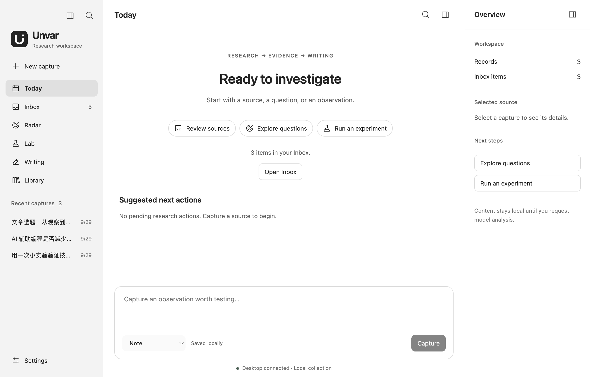

<p align="center">
  
</p>

# Unvar · 未命名变量

English | [简体中文](README.zh.md)

**Turn scattered technical ideas into verified findings and evidence-based articles.**

Unvar is an open-source desktop research and writing workspace for developers and technical creators. Collect sources, identify questions with model assistance, record experiments and evidence, and write from your own observations. Research stays in a local workspace; you choose the model provider.



*English interface with illustrative sample content. Saved content retains its original language.*

## What you can do

| Task | Features |
| --- | --- |
| Capture useful material | Save URLs, notes, questions, judgments, experiment ideas and code; tag, edit, archive and restore records |
| Find questions worth testing | Radar extracts claims, proposes questions and scores their relevance, experimentability and evidence potential; edit questions or override scores |
| Test your assumptions | Lab records predictions, baselines, methods, metrics, timers, observations, results and limitations |
| Build evidence-linked findings | Generate candidates from completed experiments, link supporting or contradicting evidence, then review and confirm them yourself |
| Write from your research | Record your perspective, confirm a Fact Pack, generate and edit an outline and draft, review, and export Markdown |
| Organize your knowledge | Search captures and research results in Library; copy or switch local workspace folders |

## From a source to an article

**Capture → Question → Experiment → Finding → Writing**

For example, investigate whether AI-assisted coding reduces total task time. Collect your observations, define a testable question, record a prediction and comparison method, and measure review and rework time. Use the results to form a finding and write an article grounded in your experience.

Models assist with analysis and writing. You supply predictions, personal observations and opinions, and decide whether findings and articles are ready. Changes to confirmed findings or writing evidence require renewed review of the relevant confirmation state.

## Get started

Installer builds are configured for macOS (Apple Silicon / Intel DMG) and Windows x64. Check [GitHub Releases](https://github.com/xiongbuer-ai/Unvar/releases) for published assets; use the source instructions below if no matching asset is available. Code signing and macOS notarization are not enabled in the current packaging configuration.

Run from source with **Node.js 24.12.0 or newer in the 24.x line**, **pnpm 11.0.9**, and a graphical desktop session.

```sh
git clone https://github.com/xiongbuer-ai/Unvar.git
cd Unvar
pnpm install --frozen-lockfile
pnpm dev
```

Initial setup downloads dependencies and Electron. A native compiler toolchain may be required if a prebuilt database dependency is unavailable. To run a local build, use `pnpm build`, then `pnpm start`.

1. Save a note or URL in Today or Inbox.
2. Enter your research focus in Settings. Configure a provider, model and API key for model assistance.
3. Send a capture to Radar, analyze it, and turn a question into an experiment.
4. Record your experiment and findings in Lab, then continue in Writing.

See the [usage guide](docs/en/usage.md) for detailed instructions. Local capture, organization and search do not require a model key. Analysis and generation require a configured provider.

## Optional assistance and decision history

- **Pi evidence interview** reads related research and suggests follow-up questions. Only your answers enter the Fact Pack, which still requires confirmation. The fixed interview remains available.
- **Jev scoring** uses a separately configured OpenRouter key, preserves scoring provenance and history, and explicitly labels Rules fallback on failure.
- **Decision Log** in Library compares model suggestions with human decisions and lets you record subsequent outcomes.

## Build installers

After installing dependencies, run the matching command on the target platform. Output is written to `dist/installers/`.

```sh
pnpm package:mac:arm64
pnpm package:mac:x64
pnpm package:win:x64
node scripts/checksums.mjs
```

The manually triggered `Build unsigned installers` GitHub Actions workflow runs lint, type checks and tests before building and uploading all three targets. It does not create a GitHub Release.

## Your data

- Content and configuration live in a selectable local workspace folder.
- API keys stay in the system credential store and are excluded from workspace sync.
- Model operations send the relevant source text, research context or evidence to your selected provider.
- Source retrieval uses the system proxy and reads HTML or plain text. Capture excerpts manually when a page requires login or script rendering.
- The interface supports Simplified Chinese and English. Switching languages does not translate saved research.

Quit Unvar completely before syncing through Git or a cloud drive. Finish synchronization before opening on another device, and edit on one device at a time. Database conflicts cannot be merged automatically. On macOS, use Cmd+Q to quit; closing the window keeps the app running.

## Documentation

- [Chinese illustrated getting-started guide](docs/zh/getting-started.md)
- [Documentation index](docs/en/README.md)
- [Research and writing guide](docs/en/usage.md)
- [Model configuration and network troubleshooting](docs/en/network-setup.md)
- [Workspaces, backups and synchronization](docs/en/workspace-folders.md)
- [Brand and icons](docs/en/brand.md)

- [Packaging and installation verification](docs/en/packaging.md)

## License

[GPL-3.0-only](LICENSE)
