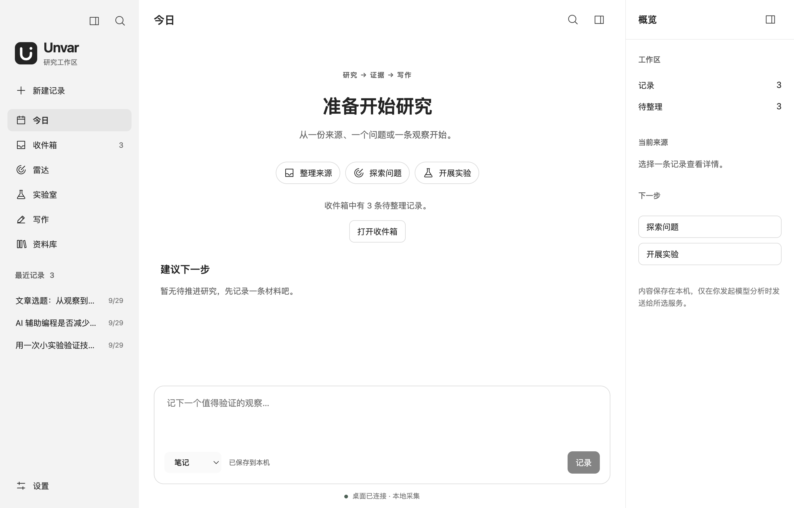

<p align="center">
  
</p>

# Unvar · 未命名变量

[English](README.md) | 简体中文

**把零散的技术线索，变成经过验证的结论和有依据的文章。**

Unvar 是面向开发者与技术创作者的开源桌面研究与写作工作台。你可以收集网页、笔记和问题，借助模型筛选值得验证的方向，记录实验与证据，再把自己的观察整理成文章。研究内容保存在本地，模型服务由你选择。



*中文界面，使用演示内容展示。*

## Unvar 能做什么

| 你想做的事 | 对应功能 |
| --- | --- |
| 随手记下值得研究的材料 | 收件箱支持链接、笔记、问题、判断、实验想法和代码片段，可添加标签、编辑、归档与恢复 |
| 从材料里找出值得验证的问题 | 雷达提取主张、生成问题，并按相关性、可实验性、证据潜力等维度评分；你可以修改问题和调整评分 |
| 用实验检验判断 | 实验室记录预测、基线、方法、指标、计时、观察日志、实际结果和局限 |
| 沉淀有依据的结论 | 从已完成实验生成候选结论，关联支持、反驳或背景证据，由你审阅和确认 |
| 写出自己的技术文章 | 写作区收集你的观察与观点，整理事实包，辅助生成提纲、正文和审阅意见，导出 Markdown |
| 找回材料并管理研究数据 | 资料库检索记录与研究成果；工作区文件夹集中保存内容和配置，支持复制与切换 |

## 从一条线索到一篇文章

**收集线索 → 提炼问题 → 开展实验 → 确认结论 → 整理文章**

例如，你想知道“AI 辅助编程是否减少了整体耗时”：先记录观察与材料，在雷达中明确可验证的问题；再在实验室记录预测与对照方法，记下审阅和返工时间；根据结果确认结论，最后结合自己的经历完成文章。

模型负责辅助分析和组织内容。实验预测与作者经历、观点由你填写，结论确认和文章是否就绪也由你决定。修改已确认的结论或写作依据后，需要重新核对相应确认状态。

## 开始使用

仓库已配置 macOS（Apple Silicon / Intel）DMG 和 Windows x64 安装包构建。安装包下载以 [GitHub Releases](https://github.com/xiongbuer-ai/Unvar/releases) 实际发布的附件为准；若没有对应附件，可按下方步骤从源码启动。当前构建配置未启用代码签名或 macOS 公证。

源码启动需要 **Node.js 24.12.0 或更新的 24.x 版本**、**pnpm 11.0.9** 和图形桌面环境。

```sh
git clone https://github.com/xiongbuer-ai/Unvar.git
cd Unvar
pnpm install --frozen-lockfile
pnpm dev
```

首次安装需要下载依赖与 Electron；原生数据库依赖缺少预编译包时，需要本机编译工具链。构建后运行可使用 `pnpm build`，再执行 `pnpm start`。

1. 打开「今日」或「收件箱」，保存第一条笔记或链接。
2. 在「设置」填写研究方向；如需模型辅助，配置服务、模型和 API Key。
3. 将记录发送到「雷达」，分析来源并选择一个问题创建实验。
4. 在「实验室」记录实验与结论，再进入「写作」整理文章。

第一次使用可跟着[中文图文入门指南](docs/zh/getting-started.md)走完配置、研究和文章导出。详细操作见[使用指南](docs/zh/usage.md)。仅记录、整理和检索本地内容不需要模型密钥；模型分析与生成需要可用的服务配置。

## 可选辅助功能

- **Pi 证据采访**：在写作页启用后，读取相关研究并提出追问。只有你填写的回答进入事实包，仍需人工确认；也可使用固定采访。
- **Jev 评分**：在设置中单独配置 OpenRouter Key，为雷达问题评分，保留评分来源与历史。失败时明确标记 Rules 回退。
- **决策记录**：在资料库查看模型建议与人工判断，记录审阅理由，并补充后续观察结果。

## 构建安装包

完成依赖安装后，在对应平台执行以下命令。产物位于 `dist/installers/`。

```sh
pnpm package:mac:arm64  # macOS Apple Silicon
pnpm package:mac:x64    # macOS Intel
pnpm package:win:x64    # Windows x64
node scripts/checksums.mjs
```

GitHub Actions 的 `Build unsigned installers` 工作流可手动触发，先运行 lint、类型检查与测试，再构建三个平台的安装包并上传产物。该工作流不会自动创建 Release。

## 数据与隐私

- 内容和配置存放在本地工作区，可选择文件夹、复制工作区或打开已有工作区。
- API Key 保存在系统凭据存储中，不写入工作区，也不随工作区同步。
- 发起模型分析、结论生成或写作操作时，相关正文、研究背景或证据会发送给所选模型服务。
- 网页采集使用系统代理，读取 HTML 或纯文本；需要登录或依赖脚本渲染的页面可改为手动摘录笔记。
- 支持简体中文和 English 界面。切换语言不会翻译已保存的研究内容。

跨设备使用时，先完全退出应用，等待 Git 或云盘同步完成，再在另一台设备打开。同一时间只在一台设备编辑；不支持数据库冲突自动合并。详见[工作区与同步](docs/zh/workspace-folders.md)。

## 文档

- [中文图文入门指南（公众号稿）](docs/zh/getting-started.md)
- [文档导航](docs/zh/README.md)
- [使用指南：收集、研究与写作](docs/zh/usage.md)
- [模型配置、网页采集与网络排查](docs/zh/network-setup.md)
- [工作区、备份与跨设备同步](docs/zh/workspace-folders.md)
- [品牌与图标](docs/zh/brand.md)

- [打包与安装验收](docs/zh/packaging.md)

## 许可证

[GPL-3.0-only](LICENSE)
