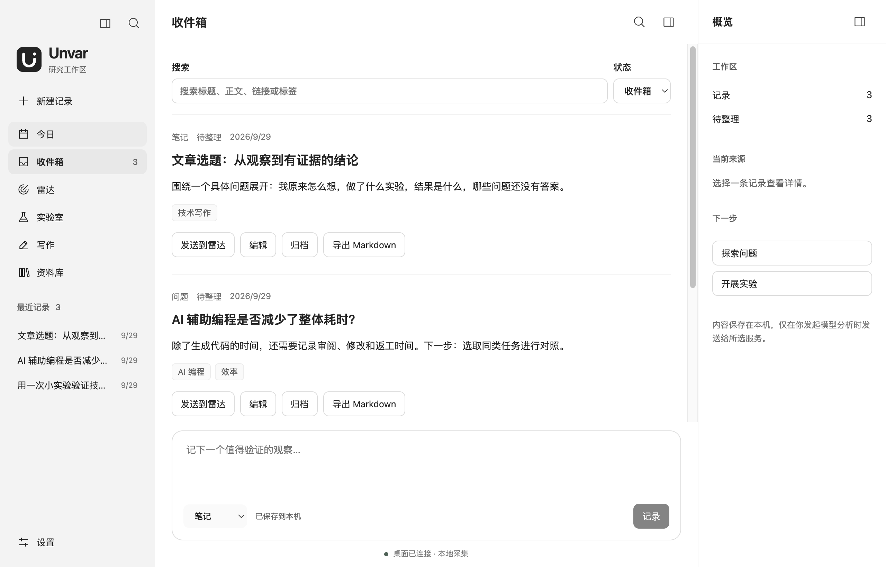

# Usage guide

English | [简体中文](../zh/usage.md)

## 1. Capture material worth investigating

Use quick capture at the bottom of Today or Inbox, or choose **New capture** to enter the full details. Supported types include URLs, notes, questions, judgments, experiment ideas and code snippets. Add descriptive titles and tags to make records easier to find.

*Chinese interface with illustrative sample content, not actual research results. The same controls are available in English.*

Captures are saved locally. Saving does not automatically call a model. Archive records you do not currently need and restore them from the archived view. Individual captures can be exported as Markdown.

## 2. Define questions in Radar

Enter your research focus in Settings and [configure a model provider](network-setup.md). Select a capture and choose **Send to Radar**, or select a source and provider directly in Radar, then choose **Analyze source**.

Radar extracts claims, proposes questions, and scores work relevance, experimentability, evidence potential, uniqueness and series potential. Without a research focus, relevance stays at 0 and questions go to Backlog for human review.

Review the questions and proposed experiments. Edit a question or override its score when needed, supplying a reason for the change. Choose **Create experiment** for a question worth pursuing. If analysis fails or is interrupted, check the message and retry manually.

## 3. Test your prediction

Open **Lab → Experiments** and enter your prediction, baseline, method and metrics. All four are required before starting. Your prediction is locked when you first start the experiment, keeping the original expectation distinct from later interpretation.

Experiments progress through Idea, Ready, Running, Analyzing and Done. Save edits before changing status or operating the timer.

- Track time with the timer, pausing and resuming as needed. Its state survives restarts.
- Use observation logs to record what actually happened.
- Record results, limitations, human time, interventions, bugs and rework, and assess trust.
- Export the experiment as Markdown to retain its evidence.

## 4. Develop and confirm findings

In **Lab → Findings**, select completed experiments and a model to generate a candidate. The model proposes a finding; it does not accept it automatically.

Check the finding, confidence, counter-evidence and limitations against the original experiment records. Evidence can support, contradict or provide context for a finding. Enter your review reason, then confirm or reject it. Confirmation requires at least one linked completed experiment.

Editing an accepted finding requires confirmation again. Saving edits and confirming are separate actions.

## 5. Write from evidence

Create an article in **Writing**, selecting a completed experiment or accepted finding as its source.

1. **Author interview**: enter your own observations, experiences, opinions and open questions, then save the interview.
2. **Fact Pack**: choose **Build Fact Pack**, check the facts, source evidence, limitations and interview answers, then choose **Confirm Fact Pack**.
3. **Outline and draft**: select a model and generate an outline, review it, then generate the draft. Edit the outline or body and provide an editorial reason; save one section at a time.
4. **Review**: choose **Review draft** and examine each issue. After changing the body, review the current version again.
5. **Export**: explain your decision and choose **Mark Ready**, then export the article as Markdown.

Changes to sources or interview answers require checking and confirming the Fact Pack again. Editing the outline requires a new draft. Available actions depend on the current content and confirmation state.

## Search and interface controls

- **Cmd/Ctrl+K** opens Library and focuses search for captures and research results.
- **Settings → Interface preferences** switches between Simplified Chinese and English. It changes the interface only, without translating saved content.
- The upper-left button collapses navigation; the upper-right workspace button toggles the overview.
- On macOS, closing the window leaves the app running. Use **Cmd+Q** to quit completely.

See [Workspaces and synchronization](workspace-folders.md) for storage and migration, or [Models and networking](network-setup.md) for connection and retrieval issues.
