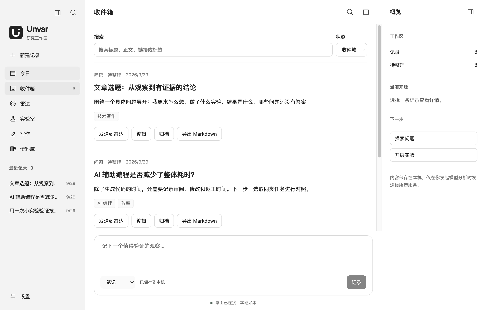

# 使用指南

[English](../en/usage.md) | 简体中文

## 1. 收集值得研究的线索

在「今日」或「收件箱」底部快速记录，也可以点击「新建记录」填写完整信息。支持链接、笔记、问题、判断、实验想法和代码片段。为记录添加明确的标题和标签，便于后续搜索。

*截图使用演示内容，不代表真实研究结果。*

记录保存到本机，不会因保存操作自动调用模型。暂时不需要的记录可以归档，并在归档视图恢复。记录可单独导出为 Markdown。

## 2. 在雷达中明确问题

先在「设置」填写研究方向，并[配置模型服务](network-setup.md)。选择一条记录，点击「发送到雷达」，或直接在雷达中选择来源与服务，再点击「分析来源」。

雷达从材料提取主张、生成问题，并按工作相关性、可实验性、证据潜力、独特性和系列潜力评分。没有填写研究方向时，相关性为 0，问题进入待评估列表，需要人工判断。

查看问题与实验建议，必要时修改内容或调整评分，并填写修改原因。选中值得继续的问题，点击「创建实验」。分析失败或中断时，检查提示后手动重试。

## 3. 用实验检验预测

进入「实验室 → 实验」，填写你的预测、基线、方法和指标。开始前这四项都必须填写；预测在首次开始实验后锁定，帮助你区分事前判断与事后解释。

实验按想法、就绪、进行中、分析中、已完成推进。操作状态或计时之前，先保存正在编辑的内容。

- 使用计时器记录投入时间，可以暂停或继续；计时状态跨重启保留。
- 用观察日志记录实际发生的情况。
- 填写结果、局限、人工耗时、介入次数、错误和返工情况，并评估可信度。
- 完成后可导出实验 Markdown，保留研究依据。

## 4. 提炼并确认研究结论

在「实验室 → 研究结论」选择已完成的实验和模型，生成候选结论。模型提出建议，不会自动确认。

核对结论、可信程度、反证与局限，查看关联实验的原始记录。证据关系可以是支持、反驳或背景。填写自己的审阅理由，再确认或拒绝结论；确认前至少需要关联一个已完成实验。

编辑已确认结论后，需要重新确认。保存修改和确认是两个独立操作。

## 5. 从证据开始写作

在「写作」中新建文章，选择已完成实验或已确认结论作为来源。

1. **作者采访**：填写你自己的观察、经历、观点和尚未确定的问题，保存采访。
2. **事实包**：点击「整理事实包」，核对事实、来源证据、局限及采访回答，再点击「确认事实包」。
3. **提纲与正文**：选择模型生成提纲，核对后生成正文。你可以编辑提纲和正文，并填写编辑理由；每次保存一个部分。
4. **审阅**：点击「审阅正文」，逐项检查审阅意见；修改正文后，重新审阅当前版本。
5. **导出**：填写判断理由并「确认就绪」，再导出文章 Markdown。

来源或采访变化后，事实包需要重新核对和确认；修改提纲后，需要重新生成正文。界面会根据当前内容与确认状态开放下一步操作。

## 查找与界面操作

- **Cmd/Ctrl+K**：打开资料库并聚焦搜索，可查找记录与研究成果。
- **设置 → 界面偏好**：切换简体中文或 English；只改变界面语言，不翻译内容。
- 左上角按钮折叠导航，工作区右上角按钮切换概览。
- macOS 上关闭窗口后应用仍在运行；完全退出使用 **Cmd+Q**。

内容保存与迁移见[工作区与同步](workspace-folders.md)；模型连接和采集问题见[模型与网络](network-setup.md)。
